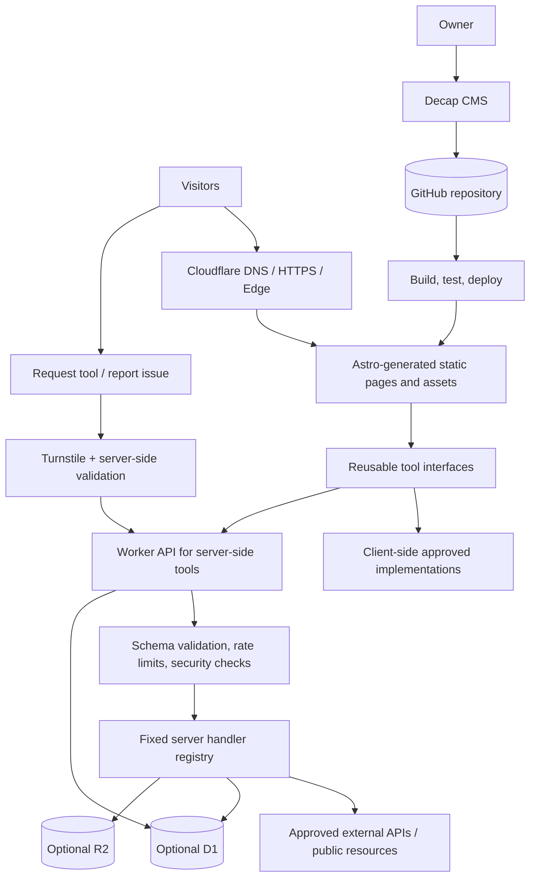

# System Architecture

**Project:** ToolXDev  
**Version:** 1.0  
**Architecture style:** Static-first website with isolated serverless APIs

## 1. Recommended stack

| Concern | Recommendation | Reason |
|---|---|---|
| Frontend | Astro + TypeScript | Content-oriented pages with minimal client JavaScript |
| Hosting | Cloudflare Workers Static Assets | Static delivery plus optional Worker routes |
| Source control | GitHub | Version history, reviews, and automated deployment |
| Content admin | Decap CMS | Git-backed content editing |
| Build/deploy | GitHub integration or documented CI deployment | Repeatable build and release |
| Server-side API | Cloudflare Workers | Only for tasks requiring server execution |
| Feedback storage | Cloudflare D1, if needed | Structured tool requests and reports |
| File storage | Cloudflare R2, if needed | Temporary/generated files or a larger media library |
| Spam prevention | Cloudflare Turnstile plus server validation | Reduces automated submissions; not a replacement for validation |
| AI | Optional Workers AI or approved provider | Add only after core tools work and limits are understood |
| Analytics | Privacy-conscious analytics | Measure performance and useful product signals |

**Important:** Verify current platform pricing, free quotas, framework compatibility, and deployment requirements before implementation. The architecture should not depend on a claim that any free tier is unlimited.

## 2. High-level architecture

## 3. Main design rule: content is not executable code

A CMS entry describes a tool. The tool implementation is written and tested in the repository.

Example content fields:
- `name`
- `slug`
- `category`
- `shortDescription`
- `executionMode`
- `implementationId`
- `intro`
- `howToUse`
- `features`
- `examples`
- `limitations`
- `privacyNotice`
- `faqs`
- `relatedTools`
- `seoTitle`
- `seoDescription`
- `status`
- `featured`

`implementationId` must match a known identifier in a fixed registry. Never use CMS values as dynamic import paths, shell commands, JavaScript source, or arbitrary server handler names.

## 4. Execution modes

### 4.1 Client-side
The browser performs the task. Use for word counting, JSON formatting, text transformations, and suitable image operations.

Benefits:
- No per-operation backend request.
- Inputs can remain on the device.
- Reduced server cost and privacy exposure.

Risks:
- Browser memory/CPU limits.
- Browser APIs and format support vary.
- Users can modify client code and inputs.
- Client-side validation does not protect a paid or privileged server API.

Mitigations:
- File-size, pixel-count, input-length, and workload limits.
- Safe DOM rendering.
- Avoid `eval`, `Function`, and execution of pasted input.
- Use maintained dependencies and test malformed inputs.
- Make privacy claims only when the implementation supports them.

### 4.2 Server-side Worker
Use only when the task needs a private secret, a permitted remote fetch, server-only processing, or AI inference.

Request lifecycle:
1. Check HTTP method and content type.
2. Validate request schema and input size.
3. Apply rate limits / abuse controls.
4. Validate external destinations if fetching URLs.
5. Run a fixed handler with bounded resource usage.
6. Sanitize output and return a predictable response.
7. Log operational metadata only; avoid logging sensitive inputs.

### 4.3 Background job
Defer until a real use case needs asynchronous progress, retries, or multi-step processing. A queue does not remove CPU, memory, storage, or third-party service limits.

## 5. URL-fetching / SSRF rules

Any Worker that fetches a user-provided URL is high-risk. Do not implement an unrestricted public URL proxy.

Required protections:
- Allow only HTTP/HTTPS.
- Reject credentials embedded in URLs.
- Prefer an allowlist of supported hostnames.
- Resolve and validate destination addresses against loopback, private, link-local, reserved, and cloud metadata ranges.
- Revalidate every redirect and protect against DNS rebinding.
- Set strict timeout, redirect-count, response-size, and content-type limits.
- Do not forward visitor cookies, authorization headers, or internal headers.
- Do not return raw upstream errors or sensitive response headers.
- Add abuse controls and test bypass cases.

For the first version, favor direct browser access or a narrow allowlist rather than a general-purpose fetch endpoint.

## 6. Feedback architecture

Public endpoints:
- `POST /api/feedback/tool-request`
- `POST /api/feedback/bug-report`

Server-side behavior:
- Validate fields and maximum lengths.
- Verify Turnstile server-side.
- Rate-limit submissions.
- Normalize and sanitize stored text.
- Store minimal necessary fields in D1 or use a safe owner-reviewed alternative.
- Never send submissions directly to code execution or auto-publish them.

Admin review:
- Must require owner authentication.
- Provide status such as `new`, `reviewing`, `planned`, `resolved`, `rejected`.
- Allow deletion of spam and inappropriate content.
- Do not assume Decap CMS automatically manages D1 rows. A protected review page or separate safe workflow must be implemented.

## 7. Content publishing

For Git-backed CMS publishing:
1. Owner edits content in Decap CMS.
2. CMS writes to the configured GitHub branch/repository.
3. CI validates content and builds the site.
4. Tests run.
5. Successful changes deploy to Cloudflare.
6. Public pages and sitemap reflect published content.

Confirm the chosen Decap backend, OAuth/hosted-auth configuration, and free-plan terms before implementation. Keep drafts out of production builds. A preview link must not make private draft content publicly accessible.

## 8. SEO rendering and caching

- Pre-render public tool, category, and blog pages.
- Include unique title, meta description, canonical URL, headings, and helpful content in generated HTML.
- Generate sitemap from published canonical URLs.
- Exclude admin, API, previews, and non-indexable utility endpoints from the sitemap.
- Cache public static assets.
- Do not publicly cache private feedback, admin responses, or personalized data.
- Add suitable structured data only when it accurately describes visible content.
- Do not generate near-duplicate pages solely to target keyword variations.

## 9. Security and secrets

- Store secrets in platform secret storage, never in Git or browser bundles.
- Restrict repository write access to the owner.
- Protect admin routes and review endpoints with real authentication/authorization.
- Validate all server requests independently of browser validation.
- Use least privilege for service tokens.
- Keep dependencies updated and lock versions.
- Use safe rendering for user-supplied text and sanitized HTML where required.
- Add security headers and a restrictive Content Security Policy after testing compatibility.
- Keep public feedback submissions separate from trusted content.

## 10. Failure and quota behavior

- Return clear errors for invalid inputs.
- Fail closed when authentication, validation, or Turnstile verification fails.
- Return a useful temporary-unavailable message when quotas are exhausted.
- Do not automatically switch to paid services.
- Monitor build failures, Worker errors, and quota consumption.
- Make expensive/AI tools clearly disclose their limits.

## 11. Architecture evolution

### Phase 1
Static site, Git-backed CMS, three client-side tools, blog and SEO templates.

### Phase 2
Worker APIs, Turnstile, D1-backed feedback, private feedback review.

### Phase 3
Selected AI tools, R2 where needed, richer usage/performance reporting.

### Phase 4
Only if justified: accounts, saved preferences, scheduled jobs, or a database-backed CMS.
